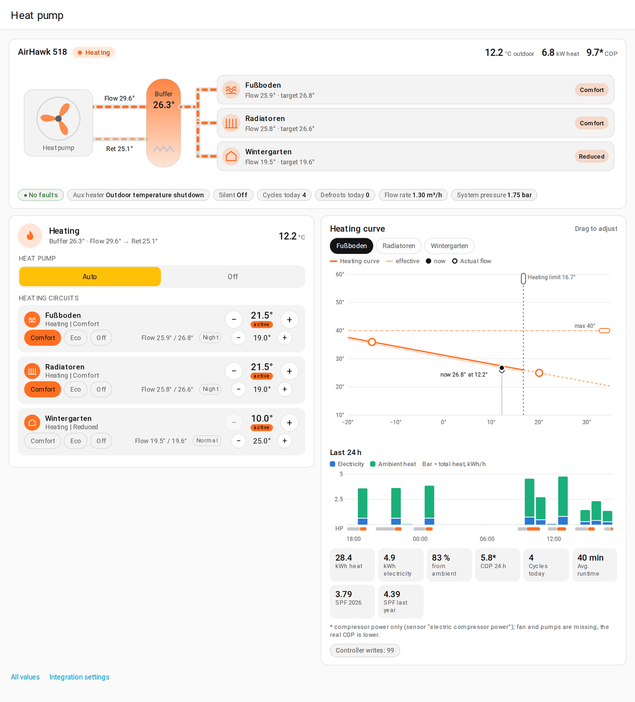
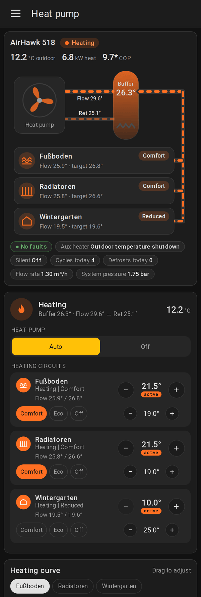
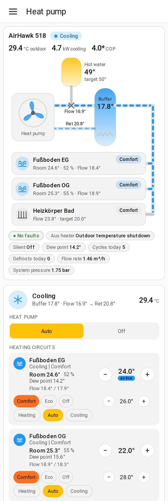
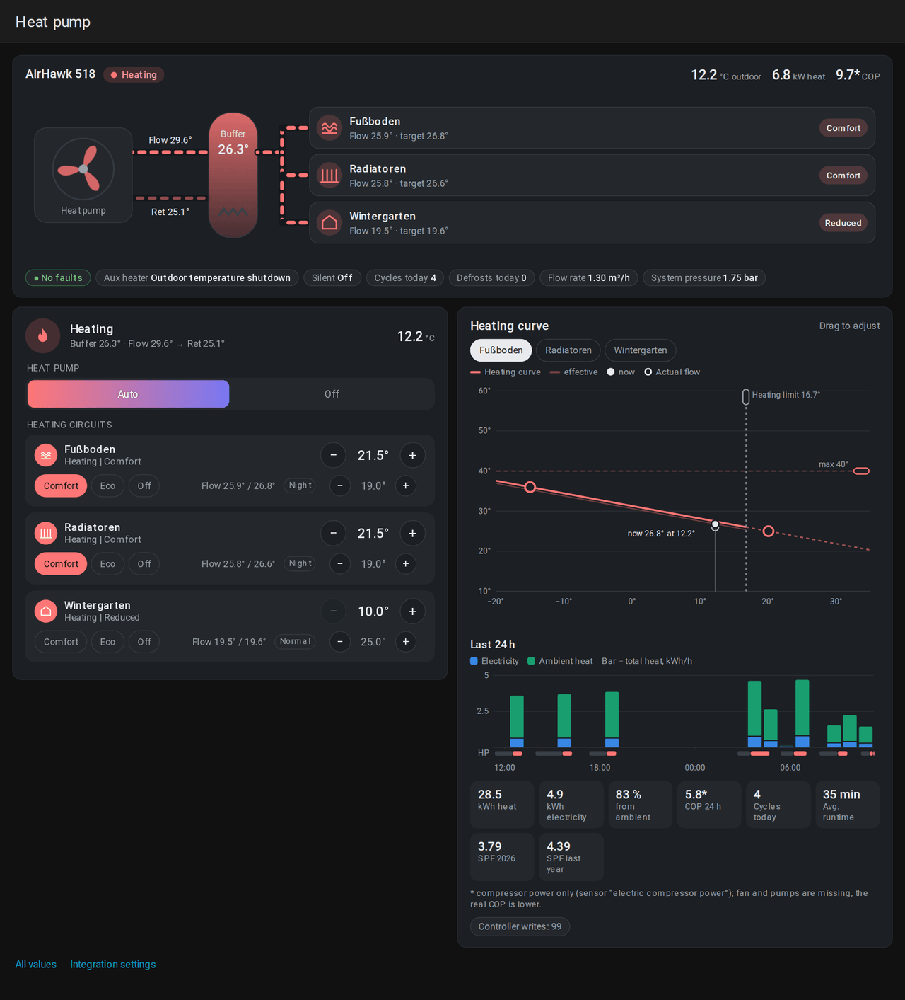

# Ochsner local OTS - Climatix - (HACS)

[](https://hacs.xyz/)
[](https://github.com/permissionBRICK/OTS-HomeAssistant/releases)
[](LICENSE)
[](https://buymeacoffee.com/permissionbrick)


**What is this repo?**

It's a way to locally read and control Ochsner heat pump settings via Home Assistant, allowing you to access all the same settings and values as the Ochsner Smart app, all without Modbus or Cloud services required.

---


## 1) Installation
### One-click install via HACS - recommended
[](https://my.home-assistant.io/redirect/hacs_repository/?owner=permissionBRICK&repository=OTS-HomeAssistant&category=integration)

#### Alternative: Search for it in HACS
This integration is listed in the default HACS repository, so you don't need to add a custom repository.

1) In Home Assistant, open **HACS**.
2) Search for **Ochsner Local OTS - Climatix Generic** and open it.
3) Click **Download** and confirm.
4) Restart Home Assistant.

#### Offline alternative: Manual folder install path
Copy this folder into your HA config directory:

- `custom_components/ochsner_local_ots/`

After you did either of these steps, restart Home Assistant, and move on to 2.

### 2) Add the integration into Home Assistant

After restarting Home Assistant, check **Settings → Devices & services** for a
discovered Ochsner heat pump and click **Add**. The integration automatically 
scans its available sensors and controls when you adopt it, which can take a second.

If no discovery card appears:

1) Choose **Add integration → Ochsner Local OTS → Scan network**.
2) Select the heat pump by its model and serial number, then confirm.
3) Alternatively, choose **Enter address manually**. If you had to go the manual IP route, also make sure that you assign a fixed IP to your heat pump in your router.

#### If the heat pump's IP address changes

The integration identifies the heat pump by its serial number and follows address changes on its own. It first tries the address that Home Assistant's DHCP data shows for the heat pump's MAC address. If that fails, it searches the local network, at most every five minutes. That search only sends the factory default username, password and PIN, so it is skipped if you entered custom ones in the advanced settings. In that case Home Assistant shows a repair issue instead.

To enter a new address yourself, open **Settings → Devices & services → Ochsner Local OTS** and choose **Reconfigure** from the entry's menu.

### 3) Heat pump dashboard



<p align="center">
  
  &nbsp;
  
</p>

The last setup step asks whether to show the **Heat pump** view in the sidebar. It contains three parts, which are also available as separate cards in the dashboard card picker (search for "Ochsner"):

- **Plant schematic:** outdoor unit, buffer tank, hot water tank and heating circuits, with live temperatures. Pipes move while water flows and take the colour of the current mode.
- **Controls:** heat pump Auto/Off, and for each heating circuit Komfort/Eco/Off and its room setpoints (−/+, in 0.5 K steps). The big stepper is the setpoint of the selected mode: the normal (day) setpoint in Komfort, the reduced setpoint in Eco or the old "Reduziert" program. The other one is in the small row below it, labelled Night in Komfort (where the time program switches to it at night) or Normal in Eco and Reduziert, and the one the circuit currently follows is marked "active". Circuits that can cool show their cooling setpoints while they cool and also get Heat/Auto/Cool. A temporary correction set in the Ochsner app shows as a chip that resets it to 0. The hot water section has its mode, setpoint and a Boost button. Circuits with a room sensor show the room temperature and humidity, and circuits that can cool also show the dew point.
- **Heating curve and efficiency:** the heating curve of each circuit with today's operating point, and the last 24 hours of heat output split into electricity and ambient heat.

The view adapts to your plant the same way the Ochsner app does. Circuits, cooling, hot water, the buffer tank, the auxiliary heater and the pool only appear if the controller reports them.

**Editing the heating curve:** drag the curve points, the heating limit or the maximum flow temperature, or move a focused point with the arrow keys. The chart shows the result at today's outdoor temperature. Nothing is written until you press **Apply**, and each changed value costs one controller write.

**Protecting the controller's flash memory:** −/+ taps are sent as a single write once you stop tapping, and switching the heat pump off asks for confirmation. The controller recalculates its targets a few seconds after a change, so a correction through the thermostat entity made right after another change is sent once the controller has settled (up to 8 seconds).

The integration also creates a **thermostat** (`climate`) entity for each heating circuit and, if the plant has one, a **water heater** entity with a hot water boost button. They work with Home Assistant's own thermostat and tile cards, voice assistants and HomeKit.

**Settings:** open **Settings → Devices & services → Ochsner Local OTS → Configure** to hide the sidebar view or to switch the colours from your Home Assistant theme to the Ochsner app's palette.



Card example (YAML):

```yaml
type: custom:ochsner-heatpump-card   # or ochsner-plant-card / ochsner-control-card / ochsner-efficiency-card
view: all                            # all | plant | controls | efficiency
color_scheme: auto                   # auto (integration setting) | ha | ochsner
```

Notes:
- The live COP is marked with \*. It divides the heat output by the compressor's electrical power only; fans and pumps aren't included, so the real COP is lower. The yearly performance factor (JAZ) next to it comes from the controller itself.
- Values that rarely change are polled less often. A change made outside Home Assistant, for example in the Ochsner app, can take a few minutes to show. Changes made in Home Assistant show immediately.
- Requires Home Assistant 2026.8 or newer.

---

## How does this work?

Instead of interacting with the heat pump over the Interface that is offered via ModbusTCP which is very undocumented and allows you to only read some values and control almost nothing, this one uses the JSON Interface that the OTS App itself uses to communicate with the heat pump (which is even less documented since it is entirely reverse engineered), except it runs entirely locally!

The local API offers an interface that allows you to read and write almost any parameter, as long as you know its ID. Since v2.0, this integration also no longer needs the Ochsner cloud to retrieve all the register IDs needed to read and control your heat pump, they already come shipped with the integration from the start, so it now works entirely offline with no reliance on the Ochsner cloud whatsoever!

This has been tested and confirmed working so far with:
 - Air Hawk 208
 - Air Hawk 518
 - Air Hawk 616
 - Air Falcon 212

However, it is plausible that it could work with any Ochsner Heat Pump that uses the Ochsner Smart app.


## Disclaimer & Warning

This project is not affiliated with or endorsed by Ochsner. It is simply a hobby project based entirely on reverse engineered information.

Tread with caution when changing random values, make sure you know the exact value you are trying to change and have correctly identified it. For the most part, the integration mostly seems to correctly parse the minimum / maximum for every value and map that to the UI so you can't set any temperature ranges that the heatpump wouldn't allow, but there are also some settings here which appear to be hidden in the app, and I have no idea what their effects might be if you try to use them.

Also of note: The settings are saved inside the Siemens Climatix Controller inside the heatpump and that uses Flash storage - which means it has a limited number of erase cycles before the chip fails. Siemens documentation seems to claim this is at 100k (100,000) write cycles. Therefore, if you plan not to just make controls available to the UI but also automate some settings, calculate a rough estimate of how many write cycles this would cause in the worst case and ensure that over the lifetime of your heatpump you stay below that total number of writes. For example: an average of 10 writes per day would last you 30 years for the rated lifetime of the flash chip. But, of course if you only control the heatpump for the most expensive 4 months of the year, you get up to 30 writes for each of those days.

The integration offers a Flash Counter value that automatically keeps track of the total number of writes you issue against the heat pump controller, so if you automate anything, keep an eye on that number.
